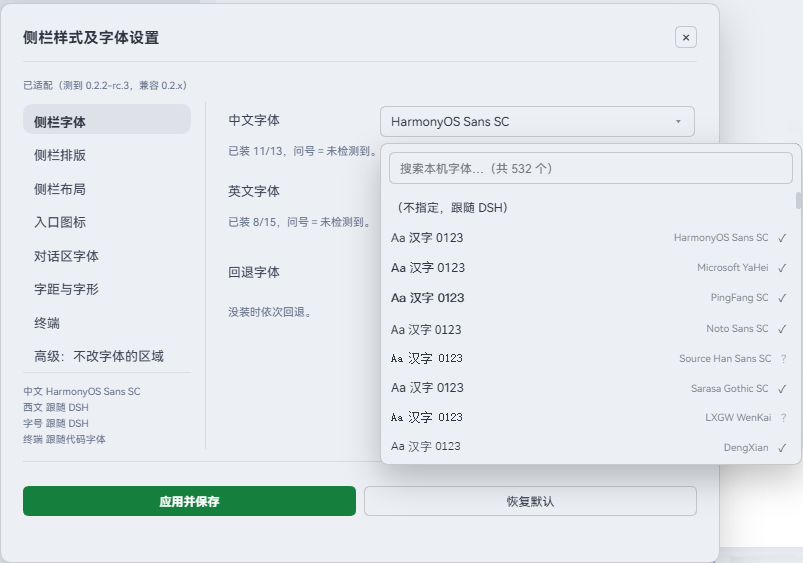

# dsh-sidebar-tuner

给 DSH 桌面端换字体、调排版的小插件。侧栏和对话区都能改，改完立即可见，设置存在本机。


DSH 自带的「设置 → 外观 → 字号」只管对话内容区，左侧栏的字号、行距是写死的，一直调不动。这个插件把两边一起接管了。

## 能改什么

| 想解决的问题 | 插件里怎么改 |
|---|---|
| 侧栏字太小、太挤 | 侧栏字号、行高、行距、整列缩放 |
| 中文和西文想用不同字体 | 中文字体 / 西文字体分开选，还能排回退顺序 |
| 字体列表里找不到自己想要的那款 | 字体选择器直接搜整台电脑的字体 |
| 侧栏太长，一屏放不下几个工作区 | 排成「图标列 + 会话列」两栏，折叠时只留图标栏 |
| 对话区想用自己的正文字体 | 对话区字体、字号、行高、代码字体单独设 |
| 终端字太小/不清晰 | 终端字体、字号、连字（实验项） |
| 数字挤在一起、看不出区别 | 字距、字重、`tnum` 等 OpenType 特性 |



## 安装

三种方式，挑一种就行。装完都要**完全退出 DSH（连托盘图标一起退）再打开**。

### 1. 插件市场

在 DSH 里打开插件市场（dsh-market），搜 `dsh-sidebar-tuner`，点安装。一条命令都不用敲。

> 市场条目还在审核收录，搜不到时用下面两种。

### 2. npm

```powershell
cd "$env:USERPROFILE\.dsh\profiles\desktop"
corepack pnpm@11 add dsh-sidebar-tuner
```

装完在这份 `package.json` 的 `dsh.profile.bundles` 里加一行 `"dsh-sidebar-tuner"`。想锁版本写 `dsh-sidebar-tuner@0.3.0`。

### 3. GitHub

跟仓库最新提交，或者 npm 用不了时走这条：

```powershell
cd "$env:USERPROFILE\.dsh\profiles\desktop"
corepack pnpm@11 add "github:tangolee/dsh-sidebar-tuner#v0.3.0"
```

把 `#v0.3.0` 换成 `#main` 就是跟最新提交。装完同样要在 `dsh.profile.bundles` 里加 `"dsh-sidebar-tuner"`。

> 自己改代码：`corepack pnpm@11 add "dsh-sidebar-tuner@link:<你的源码目录>"`，改完重启就生效，不用重新打包。

## 怎么用

侧栏图标列里有个画笔图标（可以在设置里换成滑杆、色卡或调色板），点它打开面板。左边一列是分类，右边是这一类的设置项，不再需要一路往下滚：

```
侧栏字体 · 侧栏排版 · 侧栏布局 · 入口图标
对话区字体 · 字距与字形 · 终端 · 高级
```

左栏底部一直显示当前生效的中文、西文、字号和终端字体，不用切来切去确认。

- **开关类**（并排布局、折叠行为、悬停名称等）点一下立即生效
- **数字类**（字号、行高、行距等）改完点「应用并保存」
- 想全部回到初始状态点「恢复默认」
- 面板底部的「应用并保存」会写进本机的 `override.json`，下次打开还在

### 选字体

点任何一个字体字段会弹出搜索框（上面那张图里打开的就是它）：

- 输入几个字母就过滤，比如 `display` 只剩带 Display 的字体
- 每一项都用那个字体自己渲染，同名同姓的 `Inter` / `Inter Display` 一眼能分出来
- 右边的 ✓ 表示本机装了，`?` 表示没检测到，选了会退回下一个字体
- `Esc` 关掉，`Enter` 直接选第一个匹配项

### 关于终端

终端的字体是在终端标签创建时读一次的，所以**改完字体要关掉那个终端标签再重开**才会变。字号和字距默认是关的——xterm 内部按 13px 固定排版，强行改会有光标错位风险，需要时再开。

## 常见问题

| 现象 | 原因与处理 |
|---|---|
| 装完没反应 | 没完全退出 DSH。托盘图标右键退出，再打开 |
| 数字改了没变化 | 数字项要点「应用并保存」，开关类才是即时生效 |
| 选了字体没变 | 选择器里标 `?` 的表示本机没装，会退回下一个字体 |
| 折叠后没有会话列表 | 折叠就是全部收起。两栏布局要在展开状态用 |
| 侧栏底部的计费卡没跟着缩放 | 故意的。计费卡按自己的像素排版，跟着缩放会挤成一团，可以在「高级」里调整这个名单 |
| `dsh plugin add` 装不上 | 桌面端的 profile 由 Electron 独占，命令行会被拒绝，按上面的 `pnpm add` 装 |
| 改了 `cordis.patch.yml` 要重启吗 | 要。面板里改设置不用重启 |

## 兼容性

DSH 桌面端 0.2.x，声明 `engines.dsh: >=0.2.0-rc.1 <0.3.0-0`，实测 0.2.2-rc.3。面板顶部有一行适配状态，正常显示「已适配」，找不到侧栏锚点会变黄提醒。

插件不联网：图标是内联 SVG，没有 CDN、远程字体和图片外链，断网照常用。

## 更多

- 完整配置项与注释示例：[examples/cordis.patch.example.yml](examples/cordis.patch.example.yml)
- 每个版本改了什么：[Releases](https://github.com/tangolee/dsh-sidebar-tuner/releases)
- 老版本：[0.2.x](https://github.com/tangolee/dsh-sidebar-tuner/tree/v0.2.3)

## 许可

[MIT](LICENSE) © 2026 tangolee · 图标来自 [Lucide](https://lucide.dev)（ISC，见 [THIRD_PARTY_NOTICES.md](THIRD_PARTY_NOTICES.md)）
