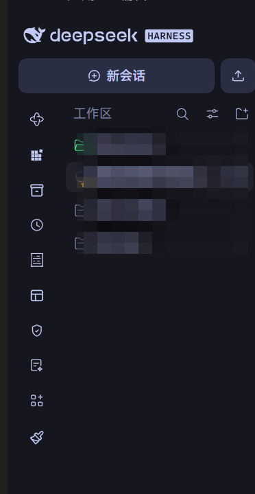
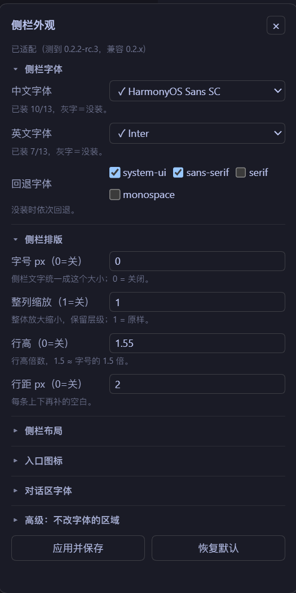

# dsh-sidebar-tuner

给 DSH 桌面端的侧栏和对话区调字体、字号、行距，并把侧栏排成「图标列 + 会话列」两栏。

[](https://www.npmjs.com/package/dsh-sidebar-tuner)
[](LICENSE)
[](#兼容性)
[](#兼容性)



DSH 自己的「设置 → 外观 → 字号」只作用于对话内容区，左侧栏用的是写死的像素值，所以侧栏的字号、行距一直调不动。这个插件把侧栏和对话区的排版都接管了，改完立即生效，存在本机。

## 能改什么

- **字体** — 中英文字体分开选，本机装没装一眼能看出来
- **排版** — 统一字号、整列缩放、行高、行距
- **布局** — 图标列 + 会话列两栏、折叠保留图标栏、悬停显示图标名称
- **对话区** — 正文和代码字体单独设，侧栏不受影响
- **入口图标** — 调色板 / 滑杆 / 色卡 / 画笔四选一

## 安装

```powershell
cd "$env:USERPROFILE\.dsh\profiles\desktop"
pnpm add dsh-sidebar-tuner
```

在这份 `package.json` 的 `dsh.profile.bundles` 里加一行 `"dsh-sidebar-tuner"`，然后**完全退出 DSH（含托盘）再打开**。

不想走 npm 也可以直接从 GitHub 装：`pnpm add "github:tangolee/dsh-sidebar-tuner"`。改代码时用本地源码：`pnpm add "dsh-sidebar-tuner@link:<源码目录>"`。

## 用起来

点侧栏图标列最下面那个图标（默认是滑杆）打开面板。面板分六组，点标题能收起：

| 分组 | 管什么 |
|---|---|
| 侧栏字体 | 中英文字体、回退 |
| 侧栏排版 | 字号、整列缩放、行高、行距 |
| 侧栏布局 | 两栏、折叠行为、图标列宽、悬停名称 |
| 入口图标 | 换入口图标 |
| 对话区字体 | 正文与代码的字体、字号、行高 |
| 高级 | 哪些区域不跟着缩放（比如计费卡） |



数字项改完点**应用并保存**；勾选类开关勾上就生效。想全部回到初始状态点**恢复默认**。

## 常用配置

面板写入的 `override.json` 优先；也可以直接写进 `profiles/<profile>/cordis.patch.yml` 的 `sidebar-tuner` 段：

```yaml
sidebar-tuner:
  fontFamilyZh: 'HarmonyOS Sans SC'
  fontFamilyEn: 'Inter'
  lineHeight: 1.55
  rowGap: 2
  railIcon: sliders
  contentFontSize: 16
```

| 键 | 说明 |
|---|---|
| `fontFamilyZh` / `fontFamilyEn` | 侧栏中英文字体（英文排在栈首，否则会被中文字体吃掉） |
| `fontSize` / `lineHeight` / `rowGap` | 侧栏字号、行高、行距，0 = 关闭 |
| `fontScale` | 整列等比缩放，1 = 原样 |
| `compactLayout` / `collapsedRail` / `pushContent` | 两栏布局与折叠行为 |
| `railTooltips` / `railIcon` | 图标悬停名称、入口图标 |
| `contentFontZh` / `contentFontSize` / `contentLineHeight` | 对话区字体与字号，0 = 跟随 DSH |
| `contentCodeFont` / `contentCodeFontSize` | 代码字体与字号 |
| `fontExclude` | 不改字号的区域（选择器列表） |

带注释的完整示例见 [examples/cordis.patch.example.yml](examples/cordis.patch.example.yml)。

## 常见问题

| 现象 | 怎么处理 |
|---|---|
| 装完没变化 | 没完全退出 DSH，托盘图标也要退 |
| 数字改了没反应 | 数字项要点「应用并保存」 |
| 字体选了没变 | 下拉里灰字「（未安装）」表示本机没装这个字体 |
| 折叠后没有会话列表 | 折叠＝全部收起，两栏在展开态用 |
| 侧栏底部的计费卡没跟着变 | 这是有意的，见「高级 → 不改字体的区域」 |

## 兼容性

DSH 桌面端 **0.2.x**，声明范围 `engines.dsh: >=0.2.0-rc.1 <0.3.0-0`，实测 0.2.2-rc.3。
面板顶部常驻一行适配状态：正常显示「已适配」，锚点对不上会变黄提示当前 DSH 可能未适配。

插件不联网：图标是内联 SVG，没有 CDN、远程字体或图片外链，断网照常使用。

## 开发

源码结构、调试手法、版本适配规则见 [docs/DEVELOPMENT.md](docs/DEVELOPMENT.md)。

## 许可

[MIT](LICENSE) © 2026 tangolee · 入口图标来自 [Lucide](https://lucide.dev)（ISC，见 [THIRD_PARTY_NOTICES.md](THIRD_PARTY_NOTICES.md)）

