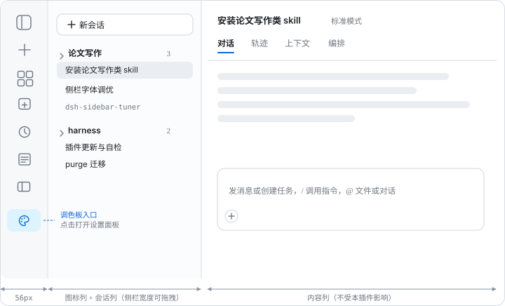

# dsh-sidebar-tuner

> 给 DSH 桌面端的左侧栏换字体、调字号、收紧行距，并把它排成「图标列 + 会话列」两栏，全部在可视化面板里点。

[](LICENSE)
[](CHANGELOG.md)
[](#环境要求)
[](package.json)

DSH 的「设置 → 外观 → 字号」只作用于对话内容区。左侧栏用的是写死的像素值，所以那些开关对它不起作用，侧栏的字号、行距一直调不动。

这个插件把左侧栏的样式单独接管：装好之后点图标列最下面的调色板，字体、字号、行高、行距、两栏布局都在面板里改，改完立即生效并保存在本机。它只管左侧栏，对话区、右侧栏和别的插件都不动。

## 能做什么

| 想达到的效果 | 用哪个设置 |
|---|---|
| 侧栏换成你喜欢的字体（思源黑体、苹方、微软雅黑等） | 中文字体 · 英文字体 · 回退项 |
| 侧栏的字统一变大或变小 | 字号（px） |
| 整列一起缩放，同时保留标题比正文大的层级 | 整列等比缩放 |
| 行与行之间不要那么松 | 行高 · 行距 |
| 像 Codex 那样左边一列图标、右边一列会话 | 图标列 + 会话列并排 |
| 只留图标时想认出每个图标是哪个入口 | 鼠标停上去浮出名称 |
| 折叠侧栏时不要整块消失，只留细长的一列图标 | 折叠时保留图标栏 |
| 入口图标想换个样子 | 图标样式（调色板 / 滑杆 / 色卡 / 画笔，来自 Lucide） |
| 对话区也想换字体、单独调字号 | 内容区（对话）里的字体项与字号 |

## 界面

<p align="center">
  
</p>

| 区域 | 宽度 | 里面是什么 |
|---|---|---|
| 图标列 | 默认 56px（可改） | 插件入口、插件市场、技能、自动化任务、上下文洞察、任务看板、更多，最下面一个调色板入口 |
| 会话列 | 侧栏宽度减去图标列 | 新会话按钮、工作区分组、会话列表 |
| 内容列 | 剩下的宽度 | 对话区，本插件不介入 |

侧栏总宽度还是由 DSH 自己的分隔条控制，拖动时图标列固定、会话列跟着变宽变窄。

## 安装

### 方式一：从 GitHub 安装（推荐）

```powershell
cd "$env:USERPROFILE\.dsh\profiles\desktop"
pnpm add "github:tangolee/dsh-sidebar-tuner"
```

仓库是公开的，不需要额外授权。

然后打开同目录里的 `package.json`，在 `dsh.profile.bundles` 数组末尾补一行：

```json
"dsh.profile.bundles": [
  "...",
  "dsh-sidebar-tuner"
]
```

**完全退出 DSH（托盘图标也要退）再打开。** 桌面端在启动时才载入插件，光重启窗口不够。

### 方式二：从本地源码安装（要改代码时用）

```powershell
git clone https://github.com/tangolee/dsh-sidebar-tuner.git <你的源码目录>

cd "$env:USERPROFILE\.dsh\profiles\desktop"
pnpm add "dsh-sidebar-tuner@link:<你的源码目录>"
```

`<你的源码目录>` 换成你实际克隆的位置，两台电脑可以不一样。同样要登记 `dsh.profile.bundles` 并重启。

`link:` 装的是链接，改完源码重启 DSH 就生效，不用重新安装。

### 卸载

```powershell
cd "$env:USERPROFILE\.dsh\profiles\desktop"
pnpm remove dsh-sidebar-tuner
```

再把 `dsh.profile.bundles` 里的 `dsh-sidebar-tuner` 删掉。

卸载前先看一眼源码目录还在不在：`link:` 安装时 `pnpm remove` 只删链接不动源码，但有些卸载工具会顺着链接把目标目录也删了。

## 上手：把侧栏调成你要的样子

1. 打开 DSH，看左侧栏最下面的调色板按钮，点开。
2. **字体**：中文字体、英文字体各选一个，回退项留 `system-ui` 和 `sans-serif` 就够。下拉里「✓」是本机装了的，灰字「（未安装）」是没装的，选了也不会生效。
3. **排版**：想统一大小就填「字号」，想保留大小层级就调「整列缩放」；行太松就调「行高」和「行距」。不需要的项目填 0（缩放填 1），等于关掉。侧栏底部的计费卡片默认不跟着这些设置变——它自己那套像素排版挤不下更大的字。
4. **布局**：想两栏就把「图标列 + 会话列并排」勾上，图标列宽按喜好填 40–72 之间。图标列只剩图标、认不出是哪个入口时，鼠标停上去会浮出名称；不想要就把「图标悬停显示名称」取消勾选。
5. **入口图标**：默认一枚滑杆图标，想换成调色板、色卡或画笔就在「图标样式」里选，选完侧栏那个入口会立刻跟着变。
6. 点 **应用并保存**。数字项这一步才生效；勾选类的开关勾上就立即生效。

关面板：右上角 `×`、按 `Esc`、或者点面板外面。

想回到初始样子，点面板底部的 **恢复默认**。

### 面板分成六组

面板从上到下按「改东西的顺序」排，每组标题点一下能收起／展开（「高级」默认收起）：

| 分组 | 里面有什么 |
|---|---|
| **侧栏字体** | 中文字体、英文字体、回退字体 |
| **侧栏排版** | 字号、整列缩放、行高、行距 |
| **侧栏布局** | 图标列 + 会话列并排、折叠相关三个开关、图标列宽、悬停显示名称 |
| **入口图标** | 图标列最下面那个入口用哪枚图标 |
| **对话区字体** | 对话区的中英文字体、回退、字号、行高、代码字体与代码字号 |
| **高级：不改字体的区域** | 哪些位置保持原字号（默认只保护计费卡片这类底部卡片） |

### 这几个数字分别是什么意思

面板里每项下面都有一行小字说明，这里再列一遍：

| 面板上的项 | 它到底是什么 | 怎么用 |
|---|---|---|
| **字号 px** | 侧栏所有文字统一成这个像素大小 | 想一刀切就填 14、15、16；填 0 = 关闭，保留 DSH 原本的大小层级 |
| **整列缩放** | 整列按比例放大缩小，标题仍比正文大 | 1 = 原样，1.1 = 放大一成，0.9 = 缩小一成 |
| **行高** | 一行文字占的高度，按字号的倍数算 | 1.5 表示行高是字号的 1.5 倍；调大后行与行更松 |
| **行距 px** | 每个条目上下额外补的空白，按像素算 | 光调行高还不够松时用它；填 0 = 关闭 |
| **图标列宽 px** | 左侧图标那一列的宽度 | 40–96 之间，默认 56 |

字号和整列缩放二选一就行：想整齐划一用字号，想保留“标题比正文大”的层次用整列缩放。

### 不想让某些区域跟着变

面板最下面「不改字体的区域」是给这类情况准备的：

| 勾选项 | 保护谁 |
|---|---|
| **侧栏底部卡片（计费、配额这类插件）** | 默认勾选。计费卡按自己的像素排版，跟着放大数字会被挤断 |
| **整个侧栏底部（连设置入口一起）** | 连“设置”那一行一起按原样显示 |
| **其它区域** | 上面没列到的插件，填它的 CSS 选择器，多个用逗号隔开，例如 `[class*="cm-"]` |

被勾上的区域保持自己的字号和行高，字号、行高、整列缩放都不作用到它身上。

### 内容区（对话）也能单独设

面板里「内容区（对话）」这一段只管右侧的对话正文，侧栏一点不受影响：

| 项 | 说明 |
|---|---|
| 中文字体 / 英文字体 / 回退字体 | 对话正文用什么字体。留空就跟 DSH「设置 → 外观 → 文字字体」走 |
| 字号 px（0=跟随） | 填 0 用 DSH 的字号设置（DSH 本身允许 10–22），填了就只在对话区覆盖 |
| 行高（0=关） | 正文的行高倍数，1.6 表示行高是字号的 1.6 倍 |
| 代码字体 | 代码块与行内代码的等宽字体，留空跟 DSH 的代码字体 |
| 代码字号 px（0=跟随） | 代码的字号，填 0 用 DSH 的代码字号设置 |

终端和输入框保持各自的等宽字体，不会被换掉。

设置保存在插件目录下的 `override.json`，只影响这台电脑。换机器要重新设一遍，或者把这份文件拷过去。

## 配置项

配置有两种写法，效果一样：

- **面板里改**：写进插件目录下的 `override.json`，优先级最高，改完立即生效。
- **改 yml**：写在 `profiles/<profile>/cordis.patch.yml` 的 `sidebar-tuner` 段，适合一开始就把默认值定好。

带注释的示例见 [`examples/cordis.patch.example.yml`](examples/cordis.patch.example.yml)，可以直接贴进 yml。

| 键 | 类型 | 默认 | 说明 |
|---|---|---|---|
| `fontFamily` | string | `''` | 完整的字体栈，填了就以它为准，忽略下面三项 |
| `fontFamilyZh` | string | `''` | 中文字体名 |
| `fontFamilyEn` | string | `''` | 英文字体名 |
| `fontFallbacks` | string[] | `[system-ui, sans-serif]` | 回退项，按顺序接在栈尾 |
| `fontSize` | number | `0` | 统一字号 px，`0` = 关闭 |
| `fontScale` | number | `1` | 整列等比缩放，`1` = 关闭 |
| `lineHeight` | number | `0` | 行高倍数，`0` = 关闭 |
| `rowGap` | number | `0` | 行距 px（额外上下留白），`0` = 关闭 |
| `fontExclude` | string[] | 侧栏底部动作槽 | 不跟字体 / 行高 / 整列缩放的区域，写 CSS 选择器；默认 `[data-slot="sidebar.footer.action"]`。面板里对应「不改字体的区域」勾选项 + 「其它区域」输入框 |
| `compactLayout` | boolean | `true` | 图标列 + 会话列并排 |
| `railTooltips` | boolean | `true` | 鼠标停在图标上时浮出这个图标的名称 |
| `railIcon` | string | `sliders` | 图标列入口的图标：`palette` / `sliders` / `swatch` / `brush`，都取自 Lucide |
| `contentFontZh` | string | `''` | 对话区中文字体，留空跟随 DSH 设置 |
| `contentFontEn` | string | `''` | 对话区英文字体 |
| `contentFontFallbacks` | string[] | `[system-ui, sans-serif]` | 对话区回退项 |
| `contentFontSize` | number | `0` | 对话区字号 px，`0` = 跟随 DSH「设置 → 外观 → 字号」 |
| `contentLineHeight` | number | `0` | 对话区行高倍数，`0` = 用 DSH 自己的换算 |
| `contentCodeFont` | string | `''` | 对话区代码的等宽字体，留空跟随 DSH 代码字体 |
| `contentCodeFontSize` | number | `0` | 对话区代码字号 px，`0` = 跟随 DSH 设置 |
| `collapsedRail` | boolean | `false` | 折叠时保留图标栏 |
| `pushContent` | boolean | `true` | 折叠时把内容列推开（`false` = 盖在上面） |
| `railWidth` | number | `56` | 图标列宽度 px |
| `settingsUi` | boolean | `true` | 是否显示调色板入口和设置面板 |
| `debugDump` | boolean | `false` | 把侧栏真实的 DOM 结构写进本地日志，排错用，平时关着 |

### 字体栈怎么拼

```
font-family: "<英文字体>", "<中文字体>", system-ui, sans-serif;
```

顺序是**英文在前、中文在后**，这不是随手定的：

- 浏览器是按字形逐个回退的。中文字体（思源黑体、苹方、微软雅黑……）基本都自带一套拉丁字形，中文排在前面时，英文也会被它命中，你选的英文字体永远轮不到。
- 反过来英文字体没有中日韩字形，中文自然落到后面的中文字体上，两边各管各的。

其余规则：

- 只填了回退项、没选具体字体时，插件不动字体，保持 DSH 原样。
- `system-ui`、`sans-serif` 这类通用名不加引号，带空格的字体名自动加引号。
- 末尾一定留一个通用名，万一字体没装也不会掉到衬线体。
- 想完全自己控制字体栈，填 `fontFamily`，其他三项就不看了（此时顺序由你决定）。

## 常见问题

| 现象 | 怎么处理 |
|---|---|
| 装完完全没变化 | 没有完全退出 DSH。托盘图标也退掉，再打开 |
| 数字改了没反应 | 数字项要点面板底部的 **应用并保存**，只改数字不点按钮不生效 |
| 计费卡片也想跟着字体变大 | 面板里取消勾选「侧栏底部卡片」，或 yml 里 `fontExclude: []` |
| 别的插件也被字体带歪了 | 勾上「整个侧栏底部」，或在「其它区域」里填它的选择器，逗号分隔 |
| 字体选了没变 | 这个字体本机没装。下拉里灰字「（未安装）」的就是，换一个带「✓」的 |
| 折叠以后没有会话列表 | 现在的做法是折叠=全部收起。把「图标列 + 会话列并排」勾上，用展开态的两栏 |
| 字号看着比旁边小 | 把面板里的字号关掉（填 0），只用整列缩放试试 |
| 想确认插件有没有跑起来 | 浏览器里访问 `http://127.0.0.1:<DSH 端口>/sidebar-tuner/tuner.css`，能返回一段 CSS 就是活的 |
| 升级 DSH 后样式错位 | 侧栏内部结构变了，更新插件到最新版即可；还没修的话到 [Issues](https://github.com/tangolee/dsh-sidebar-tuner/issues) 说一声 |

## 已知限制

- **折叠时左侧栏只留图标列，没有会话列表。** DSH 折叠时根本不渲染会话列表，插件变不出没渲染的东西，所以把两栏放在展开态，折叠表示全部收起。
- **折叠时侧栏底部区域不显示。** 跟随 DSH 原生折叠行为，不是插件删掉的。
- **只改左侧栏。** 右侧栏和对话区不受影响，这是故意的。
- **DSH 升级后可能需要跟着更新。** 样式规则贴着 DSH 的侧栏结构写，DSH 改了结构就得改插件，遇到问题先升级插件。

## 环境要求

- DSH 桌面端（`dsh-app://` 外壳的版本），网页端结构不同，不保证效果。
- 不用另外装运行时，DSH 自带的环境够用（Node 20 以上）。
- 不联网、不上传任何数据，只往页面里注入样式，设置存在本机。
- 入口图标是内联在插件里的 SVG 路径，不加载 CDN、不请求在线图标服务，断网也照常显示。

## 兼容的 DSH 版本

| 项 | 值 |
|---|---|
| 声明范围（`engines.dsh`） | `>=0.2.0-rc.1 <0.3.0-0` |
| 实测版本 | **0.2.2-rc.3**（桌面端 0.2.2-rc.3） |
| 不适配时的表现 | DSH 插件管理器会按 `engines.dsh` 拒绝安装或启用，并提示版本不符 |

插件依赖的是 DSH 侧栏与内容列的**样式锚点**（`_sidebarCol` / `_panelList` / `_centerCol` 这些类名后缀，以及 `--dsh-content-font-size` 这类排版变量）。DSH 大版本一变，这些锚点可能改名，插件就得跟着更新，所以版本范围写死在 `package.json` 里：

```json
"engines": { "node": ">=20", "dsh": ">=0.2.0-rc.1 <0.3.0-0" }
```

面板顶部还有一行自检，常驻显示适配状态：

- 正常：`DSH 0.2.2-rc.3 · 已适配（测到 0.2.2-rc.3，兼容 0.2.x）`
- 锚点缺失：`⚠ 没找到侧栏、图标列锚点，当前 DSH 版本可能未适配（本插件测到 0.2.2-rc.3）`

看到黄色警告就说明 DSH 换过结构，升级插件或把 DSH 退回 0.2.x 再试。查自己的 DSH 版本：侧栏品牌区显示的那串版本号，或看 `…\DSH\resources\app\dsh\node_modules\@deepseek-ai\dsh\package.json` 里的 `version`。

## 参与开发

源码结构、诊断路由、验证手法和提交约定见 [docs/DEVELOPMENT.md](docs/DEVELOPMENT.md)。

## 许可证

[MIT](LICENSE) © 2026 tangolee

入口图标取自 [Lucide](https://lucide.dev)（ISC 许可），原文见 [THIRD_PARTY_NOTICES.md](THIRD_PARTY_NOTICES.md)。


